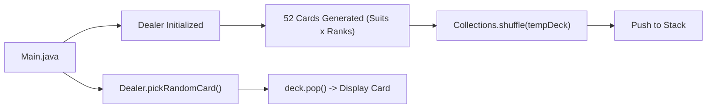

# CardGame — Java Stack-Based Deck Simulator

A modular Java console application demonstrating object-oriented programming (OOP) principles and data structures by modeling a standard 52-card deck with shuffling and dealing logic.

---

## 📌 Project Overview

This project simulates a card dealer dealing from a standard playing card deck. It models each card as an object and manages the deck using a Last-In, First-Out (LIFO) `Stack` data structure to handle drawing cards realistically.

### Key Highlights:
- **OOP Architecture:** Clear separation of concerns between `Card`, `Dealer`, and `Main` entry point.
- **Data Structures in Action:** Utilizes Java `List`, `ArrayList`, and `Stack` for deck creation, random shuffling, and dealing.
- **Robust State Management:** Handles empty-deck edge cases gracefully.

---

## 🏗️ Architecture & Workflow



---

## 📂 Repository Structure

```text
Cardgame-repo/
├── Card.java         # Card entity modeling Rank and Suit
├── Dealer.java       # Deck generation, shuffling, and stack dealing logic
├── Main.java         # Driver class and execution entry point
├── cardgame.jpg      # Output demonstration screenshot
└── README.md         # Project documentation
```

---

## ⚙️ Installation & Execution

### Prerequisites
- Java Development Kit (JDK 8 or higher)

### Steps to Run:

1. **Clone the repository:**
   ```bash
   git clone https://github.com/prakruthidevanga/Cardgame-repo.git
   cd Cardgame-repo
   ```

2. **Compile the Java source files:**
   ```bash
   javac *.java
   ```

3. **Run the program:**
   ```bash
   java Main
   ```

---

## 💻 Sample Output

```text
Picked card: 7 of Diamonds
```

---

## 👩‍💻 Author & Contributions

- **Author:** Prakruthi B R ([@prakruthidevanga](https://github.com/prakruthidevanga))
- **Role:** Individual developer — designed classes, implemented Java collections, and tested stack operations.
