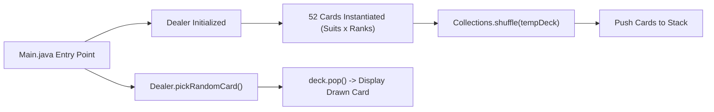

# 🃏 CardGame — Java Stack-Based Deck Simulator

<p align="center">
  
</p>

<p align="center">
  A modular Java console application demonstrating object-oriented programming (OOP) principles, collection shuffling, and data structures by modeling a standard 52-card deck with Last-In, First-Out (LIFO) stack dealing logic.
</p>

<p align="center">
  <a href="https://github.com/prakruthidevanga/Cardgame-repo">
    
  </a>
</p>

<p align="center">
  
  
  
  
</p>

---

## 📌 Table of Contents

- [📖 Project Overview](#-project-overview)
- [🎯 Objectives](#-objectives)
- [✨ Key Features](#-key-features)
- [🏗️ System Architecture & Workflow](#️-system-architecture--workflow)
- [🛠️ Technology Stack](#️-technology-stack)
- [📁 Repository Structure](#-repository-structure)
- [⚙️ Compilation and Execution](#️-compilation-and-execution)
- [💻 Sample Console Output](#-sample-console-output)
- [🔮 Future Enhancements](#-future-enhancements)
- [🤝 Contributing](#-contributing)
- [👩‍💻 Author & Accreditations](#-author--accreditations)

---

## 📖 Project Overview

Modeling real-world games using software requires clear class separation, encapsulation, and appropriate data structure selection. In card games, dealing from a shuffled deck mirrors the physical behavior of a Last-In, First-Out (LIFO) stack.

The **CardGame Simulator** implements this architecture in Java. The project separates concerns across distinct classes (`Card`, `Dealer`, and driver `Main`), initializes 52 playing card objects combining suits and ranks, randomizes the deck using `Collections.shuffle()`, and loads cards onto a `Stack<Card>` for realistic drawing operations.

🃏 **Core Mission:** Provide a clear object-oriented demonstration of Java Collections and stack data structures.

---

## 🎯 Objectives

- ♠️ **Real-World Object Modeling:** Encapsulate Rank and Suit properties within a dedicated `Card` entity.
- 🔀 **Collection Randomization:** Generate and shuffle 52 unique card objects dynamically.
- 📚 **LIFO Stack Operations:** Push shuffled cards onto a Java `Stack` and simulate realistic dealing using `.pop()`.
- 🛡️ **Boundary Validation:** Gracefully handle empty-deck states when all cards are dealt.

---

## ✨ Key Features

### 🎴 1. Modular Entity Architecture
Decoupled class design ensuring `Card`, `Dealer`, and `Main` maintain single, distinct responsibilities.

### 🎲 2. Randomized Shuffling Engine
Utilizes `java.util.Collections.shuffle()` over temporary list buffers to ensure statistically fair permutations.

### 📥 3. Stack Data Structure (`LIFO`)
Draws cards using `deck.pop()`, faithfully modeling real-world top-of-deck dealing mechanics.

---

## 🏗️ System Architecture & Workflow



---

## 🛠️ Technology Stack

<p align="center">
  
</p>

| Component | Technology | Implementation Role |
| :--- | :--- | :--- |
| **Language** | Java (JDK 8 or higher) | Core runtime and object-oriented syntax |
| **Data Structures** | `java.util.Stack`, `ArrayList` | LIFO dealing and dynamic list shuffling |
| **Utilities** | `java.util.Collections` | Deck randomization algorithm |

---

## 📁 Repository Structure

```text
Cardgame-repo/
├── Card.java         # Card entity modeling Rank and Suit
├── Dealer.java       # Deck generation, shuffling, and stack dealing logic
├── Main.java         # Driver class and execution entry point
├── cardgame.jpg      # Output demonstration screenshot
└── README.md         # Project documentation
```

---

## ⚙️ Compilation and Execution

### Prerequisites
- Java Development Kit (JDK 8 or higher)

### Steps to Run:
```bash
git clone https://github.com/prakruthidevanga/Cardgame-repo.git
cd Cardgame-repo
javac *.java
java Main
```

---

## 💻 Sample Console Output

```text
Picked card: 7 of Diamonds
```

---

## 🔮 Future Enhancements

- 🎮 **Blackjack / Poker Game Loop:** Add scoring rules and multi-player dealer turns.
- 🖼️ **GUI Interface:** Upgrade from console printouts to a graphical Java Swing / JavaFX board.

---

## 🤝 Contributing

Contributions and rule enhancements are welcomed! Feel free to open a PR.

---

## 👩‍💻 Author & Accreditations

**Prakruthi B R**  
*BCA Student specializing in Artificial Intelligence & Machine Learning*  
*Alliance University, Bengaluru (CGPA: 9.60)*  
*GeeksforGeeks Campus Mantri (2026)*

- 💻 **GitHub:** [@prakruthidevanga](https://github.com/prakruthidevanga)
- 🔗 **LinkedIn:** [Prakruthi BR](https://linkedin.com/in/prakruthi-br)
- 🌐 **Portfolio:** [prakruthidevanga.github.io](https://prakruthidevanga.github.io/)
- 📬 **Email:** [prakruthibr2006@gmail.com](mailto:prakruthibr2006@gmail.com)

---

<p align="center">
  <b>🃏 Mastering object-oriented software design through practical game mechanics.</b>
</p>

<p align="center">
  
</p>
